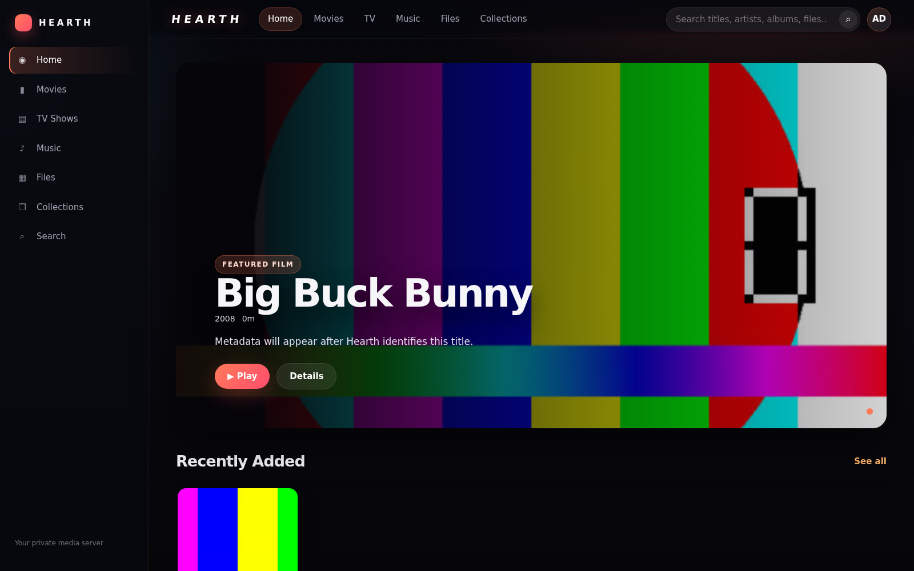
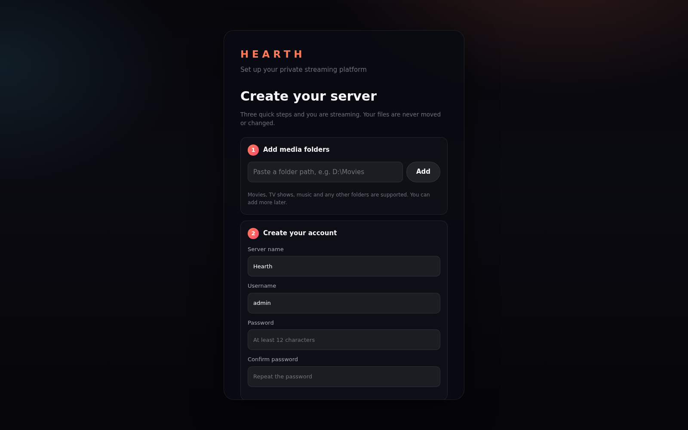
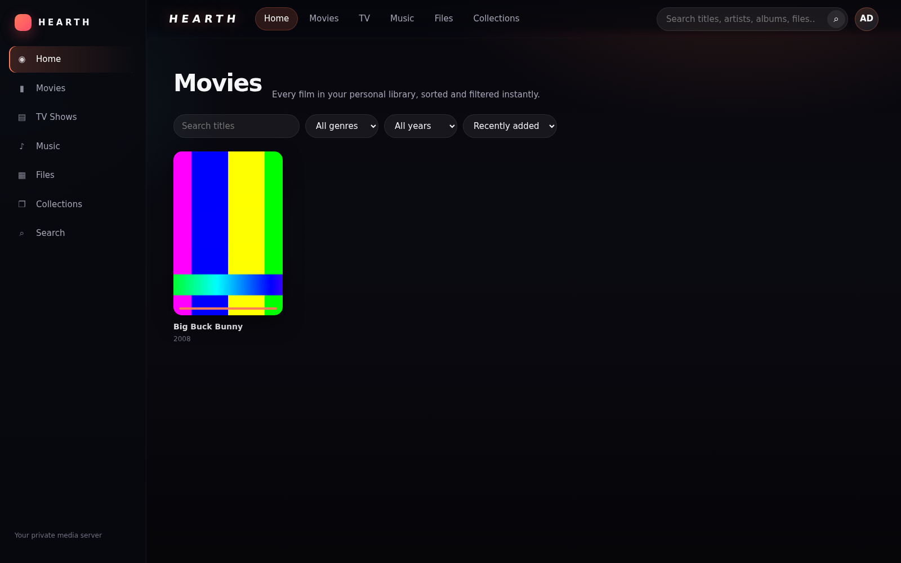
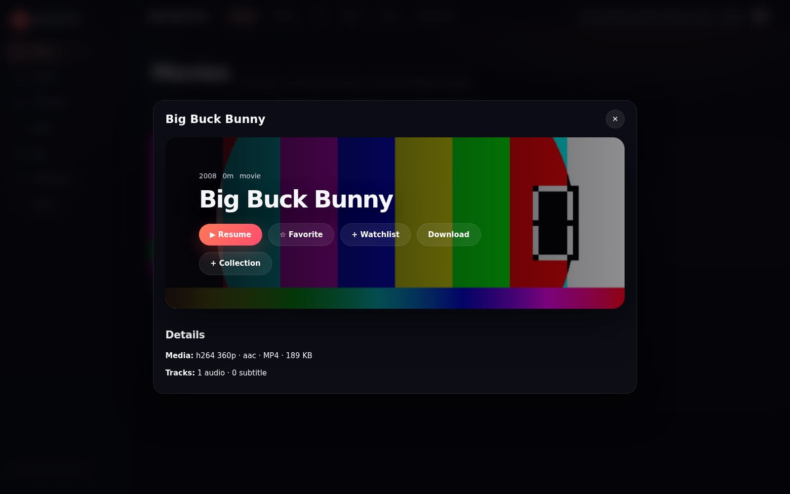
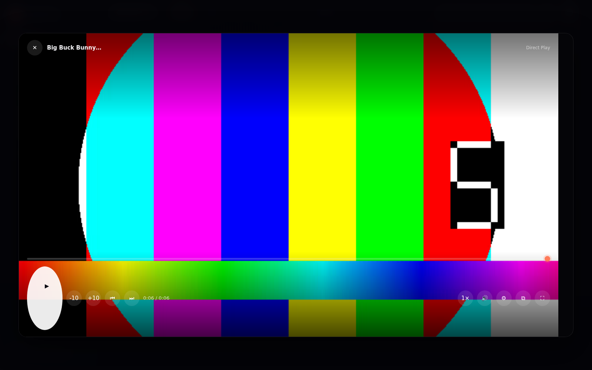

# Hearth

**Your private streaming platform — a self-hosted media server that turns a Windows PC into your own Netflix-style library, with a desktop control panel and a beautiful web app for every screen.**

[](https://github.com/thebluedogcorp/hearth/actions/workflows/ci.yml)
[](../../releases)
[](LICENSE)
[](test/smoke.js)

<p align="center">
  
</p>

---

## Why Hearth

Hearth is a single installable app for people who want their own media library without a PhD in server administration. One installer bundles the server, the desktop control panel and all media tools. There is no account to create on someone else's cloud, no telemetry, and no subscription — your movies, shows and music live on your hardware and stream to any device on your network (or your own approved remote address).

- **Setup in three steps.** Add a folder, create an account, press *Create my server*. Scanning starts immediately in the background.
- **Zero native build dependencies.** The server uses Node's built-in `node:sqlite` — nothing to compile, nothing to break.
- **Plays everything.** Compatible files stream directly (Direct Play); anything else is transcoded on the fly by a bundled FFmpeg, with automatic hardware acceleration via NVENC, Quick Sync or AMF when available.
- **Multi-user, permission-aware.** Family members get their own account, watch state and optional per-library restrictions.
- **Truly yours.** No telemetry, no external accounts, MIT-licensed source you can audit line by line.

| | |
|---|---|
|  |  |
| *First-run wizard: folders, account, done.* | *Movies library: instant search, genre and year filters.* |

## Screenshots

| | |
|---|---|
|  |  |
| *Details: media info, tracks, favorite, watchlist, download.* | *Player: Direct Play or HLS, with resume across devices.* |

## What's inside

- **Windows desktop control panel** (Electron): first-run wizard, dashboard stats, library manager, user accounts, storage and network controls, logs, backup, Windows-service installation, diagnostics.
- **Media server** (Node.js ≥ 22, zero native modules): `node:sqlite` storage, structured JSON logs with rotation, scrypt password hashing, AES-256-GCM secret storage, session cookies with CSRF protection.
- **Scanner & metadata**: recursive library scan with ffprobe, sidecar artwork/subtitles, TMDB for movies & TV and MusicBrainz for music (optional API keys; everything cached locally).
- **Playback**: Direct Play when the device supports the file, otherwise on-demand HLS (4-second segments) with quality switching, hardware-encoder probe & fallback, WebVTT subtitle conversion, preview thumbnails.
- **Files & downloads**: browse "Files" libraries, download single files or whole folders as streamed ZIP (CRC32 + ZIP64).
- **Remote access**: LAN address discovery, Tailscale detection, Cloudflare quick tunnel (bundled `cloudflared`), reverse-proxy mode.
- **Ops**: consistent SQLite backups (`VACUUM INTO`), Windows service via WinSW, health endpoint with instance identity.

## Quick start (Windows)

1. **Download** `Hearth-Setup-1.0.2-x64.exe` from [Releases](../../releases) and install it. Verify the published SHA256 if you like.
2. **Launch Hearth** — the desktop panel starts and opens the wizard. Add a media folder, create your administrator account, press **Create my server**.
3. **Watch** — the panel shows your server's web address. Open it on any device on the same network, sign in, and press play.

> No Windows desktop? Run the server on any machine with Node ≥ 22:
> ```bash
> node server/index.js --data D:\HearthData --setup-token "$(openssl rand -hex 24)"
> ```
> Then open `http://<server-address>:7341` **from that machine** to complete the browser wizard (first-run setup is restricted to the server itself for safety; the desktop app or a token can set up remotely headless installs).

## How playback works

```
Browser ──GET /api/items/:id/play──▶ Hearth server
            │ picks profile:
            │   device codecs (browser probe) + file streams
            ├── compatible ──▶ Direct Play  (api/play/:key, supports HTTP Range)
            └── needs work ──▶ HLS (api/hls/:key/…, FFmpeg segments, quality variants)
                                    ├─ hardware probe: NVENC ▸ QSV ▸ AMF ▸ libx264
                                    └─ subtitles converted to WebVTT on demand
```

## Security model (short version)

- Passwords: scrypt (N=32768). Secrets (API keys): AES-256-GCM encrypted with a 0600 master-key file.
- Sessions: HttpOnly SameSite cookies + CSRF token for browser mutations; desktop uses Bearer tokens (loopback only).
- First-run setup is a bounded window: **only** while no administrator exists **and only from the server machine**; afterwards setup is permanently closed (403/409, test-enforced).
- Path traversal protection on every file route; login rate limiting; CSP with no inline scripts; telemetry: none, anywhere.

Full details: [docs/SECURITY.md](docs/SECURITY.md).

## Remote access

- **Home network** — works out of the box; the dashboard lists your LAN addresses.
- **Tailscale** — detected automatically when installed; recommended zero-config option.
- **Cloudflare Tunnel** — bundled `cloudflared`; a quick tunnel gives you a public HTTPS URL in one click.
- **Reverse proxy** — point your own domain/CDN at the server in proxy mode.

Full guide: [docs/REMOTE-ACCESS.md](docs/REMOTE-ACCESS.md).

## Documentation

- [Installation & first run](docs/INSTALL.md)
- [Remote access](docs/REMOTE-ACCESS.md)
- [Security](docs/SECURITY.md)
- [Building from source](docs/BUILDING.md)
- [User guide (bundled PDF/HTML in `resources/docs/`)](resources/docs/)

## Development

```bash
npm install            # electron + electron-builder + hls.js
npm test               # end-to-end smoke test (39 checks, needs ffmpeg on PATH)
npm start              # run the desktop app in development
npx electron-builder --win nsis --x64   # build the Windows installer
bash scripts/fetch-vendor.sh            # fetch the Windows vendor binaries for packaging
```

The test suite creates real media files with FFmpeg, runs a real server on port 7341, and exercises setup, auth, CSRF, permissions, scanning, Direct Play, HLS, Range requests, resume, downloads, ZIP structure and backup integrity. CI runs it on Node 20/22/24.

## FAQ

**Does Hearth move or rename my files?** Never. The scanner reads; it doesn't write to your media.

**Do I need a TMDB API key?** No — libraries work fully without metadata services; posters and plot summaries are a bonus layer you can add anytime in Settings.

**Can I run it headless (Linux NAS, VM)?** The server is pure Node.js and runs anywhere Node ≥ 22 runs. The desktop panel and installer are Windows-focused; headless first-run setup is done from a local browser or the setup token.

**Where is my data?** Everything lives in one data directory (`%APPDATA%\Hearth` by default): SQLite database, artwork cache, logs, backups. Copy it, back it up, move it — that's the whole state.

**Is remote access safe?** Off by default. When you enable tunnels or LAN binding, sessions are cookie-based with CSRF protection and rate limiting; see [docs/SECURITY.md](docs/SECURITY.md) for the exact guarantees and limits.

## Contributing

Issues and PRs are welcome — see [CONTRIBUTING.md](CONTRIBUTING.md). For security vulnerabilities, please follow [SECURITY.md](SECURITY.md) rather than opening a public issue.

## License

[MIT](LICENSE) © 2026 Hearth Media. Bundled third-party software (FFmpeg, cloudflared, WinSW, hls.js, Electron) remains under its own licenses — see [THIRD-PARTY-NOTICES.md](THIRD-PARTY-NOTICES.md).
